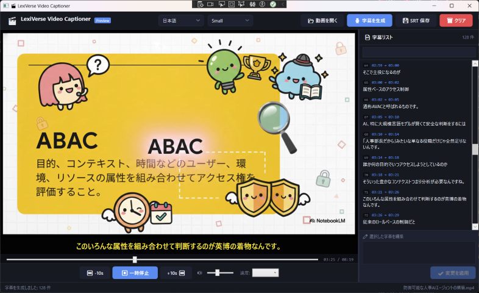

# 🎬 LexiVerse Video Captioner



**Whisper** を使ってローカルで動く動画字幕生成 WPF アプリ

---

## ✨ 主な機能

| 機能 | 詳細 |
|------|------|
| 🎙 音声→字幕 | Whisper モデルでオフライン文字起こし（クラウド API 不要） |
| ⚡ GPU 対応 | Vulkan 対応 GPU があれば自動で使用（NVIDIA / AMD / Intel、内蔵 GPU も可）。無い場合は CPU で動作 |
| 🧩 NPU 対応（任意） | AMD Ryzen AI 300 シリーズの NPU で書き起こし可能（NPU 版 whisper.cpp を用意した場合のみ。[後述](#-npu-で書き起こすamd-ryzen-ai任意)） |
| 🌐 言語選択 | 日本語 / 英語を画面上で切り替え |
| 🧠 モデル選択 | Tiny 〜 LargeV3Turbo を画面上で切り替え（標準は `LargeV3Turbo`） |
| ▶ 動画プレーヤー | WPF MediaElement による動画再生（複数動画をリストで切り替え） |
| 🟡 字幕オーバーレイ | 再生位置に合わせてリアルタイムに字幕表示 |
| ✏ 字幕編集 | リスト上で字幕テキストをその場で編集 |
| 🔍 検索フィルター | テキスト検索で字幕を絞り込み |
| 📄 SRT 読み込み | 既存の SRT を開く。動画と同名の `.srt` は自動で読み込み |
| 💾 SRT 出力 | 標準的な SRT ファイル（UTF-8 BOM 付き）として書き出し。保存先は動画と同じフォルダが初期値 |
| 🛟 未保存の確認 | 生成・編集した字幕を SRT に保存せずに閉じようとすると確認ダイアログを表示 |

---

## 🔧 セットアップ

### 必要環境

- **Windows 10 22H2 以降**
- **.NET 10 SDK**
- **Visual Studio**（任意）
- インターネット接続（初回の FFmpeg・モデルのダウンロードに必要）

### ビルド手順

```powershell
# 1. プロジェクトをクローン / フォルダを開く
cd lexiverse-video-captioner

# 2. リストア & ビルド（win-x64 をターゲット指定）
dotnet restore LexiVerseVideoCaptioner -r win-x64
dotnet build LexiVerseVideoCaptioner -r win-x64 -c Release

# 3. 実行
dotnet run --project LexiVerseVideoCaptioner -r win-x64

# （任意）単一 exe として発行
dotnet publish LexiVerseVideoCaptioner -r win-x64 -c Release
```

> **注意**: `net10.0-windows10.0.26100.0` と RuntimeIdentifier `win-x64` の指定が必須です。
> ソリューション（`.slnx`）に対して `-r win-x64` を付けるとエラーになるため、プロジェクトフォルダを指定してください。

### 🧩 NPU で書き起こす（AMD Ryzen AI・任意）

AMD Ryzen AI 300 シリーズでは、Whisper のエンコーダーを NPU で動かせます。
NPU 用は Whisper.net ではなく、AMD 版 whisper.cpp の `whisper-cli.exe` を別プロセスで実行します。

**必要なもの**

- AMD Ryzen AI 300 シリーズ（NPU 搭載）と NPU ドライバ .280 以降
- Ryzen AI ランタイム（`flexmlrt`）: 配布物を展開して `flexmlrt\setup.bat` を実行
- [amd/whisper.cpp](https://github.com/amd/whisper.cpp) を NPU 有効でビルドしたもの

**手順**

```powershell
# amd/whisper.cpp を NPU 有効でビルド
cmake -B build -DWHISPER_VITISAI=1
cmake --build build -j --config Release
```

1. ビルドしたものから次のファイルを、このリポジトリの `whisperCpp\build\bin\Release\` に置きます
   - `whisper-cli.exe` / `whisper.dll` / `ggml.dll` / `ggml-base.dll` / `ggml-cpu.dll` / `flexmlrt.dll`
2. いつも通りビルドすると、出力先の `npu\` フォルダにコピーされます（このフォルダは Git 管理外です）
3. アプリ上部の装置の選択で **「NPU (Ryzen AI)」** を選びます（ファイルを置いていない場合は選択肢に出ません）

NPU で使えるモデルは `Tiny` / `Base` / `Small` / `SmallEn` / `Medium` / `LargeV3` / `LargeV3Turbo` です
（AMD が NPU 用エンコーダーを配布しているもの）。
初回は、選んだモデル用の NPU エンコーダー（`*-encoder-vitisai.rai`、`LargeV3Turbo` は約 740MB）を自動でダウンロードします。

---

## 📦 依存パッケージ

| パッケージ | 用途 | ライセンス |
|-----------|------|-------|
| `Whisper.net` | Whisper ローカル推論 | MIT (https://www.nuget.org/packages/Whisper.net/1.9.0/license) |
| `Whisper.net.Runtime` | CPU 推論用ネイティブランタイム | MIT |
| `Whisper.net.Runtime.Vulkan` | GPU (Vulkan) 推論用ネイティブランタイム | MIT |
| `Microsoft.Extensions.Logging` / `.Debug` | ロギング | MIT |

実行時にダウンロードするもの:

| もの | 取得元 | ライセンス |
|------|--------|-----------|
| FFmpeg（`ffmpeg.exe`） | [FFmpeg-Builds](https://github.com/FFmpeg-Builds/FFmpeg-Builds) の固定バージョン（n9.0.2, win64 LGPL ビルド） | LGPL |
| Whisper モデル（Q8_0 量子化） | [sandrohanea/whisper.net](https://huggingface.co/sandrohanea/whisper.net)（Hugging Face） | MIT |
| NPU 用エンコーダー（`.rai`、NPU 使用時のみ） | [AMD の Ryzen AI Whisper コレクション](https://huggingface.co/collections/amd/ryzen-ai-whisper-npu-optimized-onnx-models)（Hugging Face） | MIT |

---

## 🗂 プロジェクト構成

```
LexiVerseVideoCaptioner/
├── App.xaml / App.xaml.cs           # アプリエントリポイント & グローバルスタイル
├── LexiVerseVideoCaptioner.csproj   # プロジェクト設定
├── Models/
│   ├── SubtitleEntry.cs             # 字幕データモデル
│   └── VideoEntry.cs                # 動画リストの 1 項目（パス + 字幕）
├── Services/
│   ├── TranscriptionService.cs      # Whisper による書き起こし・モデル管理
│   ├── NpuWhisperRunner.cs          # NPU 版 whisper-cli の実行・NPU 用エンコーダーの取得
│   ├── AudioExtractorService.cs     # FFmpeg で動画→WAV（16kHz モノラル）
│   ├── SrtExporter.cs               # SRT ファイル出力
│   ├── SrtImporter.cs               # SRT ファイル読み込み
│   ├── HashVerifier.cs              # ダウンロードファイルの SHA-256 検証
│   └── FileLoggerProvider.cs        # ログファイル出力
├── converter/
│   └── TimeSpanToStringConverter.cs # MM:SS 表示用コンバーター
└── Views/
    ├── MainWindow.xaml              # メイン UI
    └── MainWindow.xaml.cs           # コードビハインド
```

---

## 🎨 UI の操作方法

1. **「📂 動画を開く」** で動画を選択（ドラッグ＆ドロップも可。複数可）
2. 画面上部で **言語** と **モデル**、**装置**（GPU / CPU か NPU）を選択
3. **「🎙 字幕を生成」** をクリック → Whisper が音声を文字起こし
   - 初回は FFmpeg とモデルのダウンロードが発生します（`LargeV3Turbo` は約 870MB）
   - 処理時間は PC の性能・GPU の有無・モデルによって大きく変わります
   - 途中で **「⏹ キャンセル」** で中断できます
4. 右パネルの字幕リストで内容を確認・編集
5. 動画を再生すると、現在位置に対応する字幕がオーバーレイ表示
6. **「💾 SRT 保存」** で字幕ファイルを書き出し（保存先は動画と同じフォルダが初期値。**「📄 SRT を開く」** で既存の字幕も読み込めます）
7. 字幕を生成・編集してから保存せずに閉じようとすると、保存するか確認されます
   - **はい**: 動画ごとに保存ダイアログを表示（キャンセルすると終了も取り消し）
   - **いいえ**: 保存せずに終了 / **キャンセル**: 終了しない

---

## 💡 変換を速くするには

- **GPU を使う**: Vulkan 対応 GPU があれば自動で使われます。グラフィックドライバーを最新にしてください。
  変換中にタスクマネージャーの「GPU」使用率が上がっていれば GPU で動いています。
- **NPU を使う**: Ryzen AI 300 シリーズなら NPU も選べます（[設定方法](#-npu-で書き起こすamd-ryzen-ai任意)）。
  GPU より速いとは限りませんが、消費電力を抑えられます。
- **モデルを選ぶ**: `LargeV3Turbo`（標準）は Large-v3 に近い精度でより高速です。
  精度より速度を優先する場合は `Small` / `Base` を選んでください。
- **2 回目以降は速い**: 一度読み込んだモデルはアプリを閉じるまで使い回します。

---

## 📁 データの保存場所

| もの | 場所 |
|------|------|
| FFmpeg | `%LOCALAPPDATA%\LexiVerseVideoCaptioner\tools\` |
| Whisper モデル | `%LOCALAPPDATA%\LexiVerseVideoCaptioner\models\` |
| NPU 用エンコーダー | `%LOCALAPPDATA%\LexiVerseVideoCaptioner\models\`（モデルと同じ場所。`ggml_<モデル名>-encoder-vitisai.rai`） |
| NPU 版 whisper.cpp | アプリのフォルダの `npu\` |
| ログ | `%LOCALAPPDATA%\LexiVerseVideoCaptioner\logs\app.log` |
| 一時 WAV | `%TEMP%\LexiVerseVideoCaptioner\`（終了時に削除） |

> 旧バージョンでアプリのフォルダ（`tools\` / `models\`）に保存していたファイルは、起動時に自動で上記へ移動します。

---

## 🔒 セキュリティ

- FFmpeg は **バージョンを固定** し、ダウンロードした zip と `ffmpeg.exe` を **SHA-256 で検証** してから使用します。
  起動時にも `ffmpeg.exe` を検証し、一致しない場合は再ダウンロードします。
- Whisper モデルもダウンロード後に **SHA-256 で検証** します。途中で中断しても壊れたファイルは残りません。
- NPU 用エンコーダー（`.rai`）は **リビジョンを固定** してダウンロードし、**SHA-256 で検証** してから使用します。
- NPU 版 `whisper-cli.exe` はアプリのフォルダの `npu\` から **フルパスで起動** します（PATH からは探しません）。
- PATH 上に FFmpeg がインストールされている場合はそちらを使いますが、**フルパスで起動** します
  （カレントディレクトリに置かれた別の `ffmpeg.exe` が実行されることはありません）。

---

## ⚠ よくある問題

### 文字起こし結果が変・別の言語になる

→ 画面上部の **言語** が動画の言語と合っているか確認してください。
  精度が足りない場合は、より大きいモデル（`LargeV3Turbo` など）を選んでください。

### 動かない・エラーになる

→ ログファイル `%LOCALAPPDATA%\LexiVerseVideoCaptioner\logs\app.log` にエラーの詳細が出ています。

### NPU (Ryzen AI) が選択肢に出ない

→ `whisperCpp\build\bin\Release\whisper-cli.exe` を置いてからビルドし直してください。出力先に `npu\whisper-cli.exe` があるか確認してください。

### NPU で書き起こすとエラーになる

- 「NPU 用エンコーダーを読み込めませんでした」→ NPU ドライバ（.280 以降）と Ryzen AI ランタイム（`flexmlrt`）が入っているか確認してください。
- 「異常終了しました」→ 他のアプリが NPU を使っていないか確認してください。詳細はログに出ています。
- 「NPU に対応していません」→ NPU で使えるモデル（`Tiny` / `Base` / `Small` / `SmallEn` / `Medium` / `LargeV3` / `LargeV3Turbo`）を選んでください。

### モデルの読み込みに失敗する

→ `%LOCALAPPDATA%\LexiVerseVideoCaptioner\models\` から該当する `ggml_*.bin` を削除して、再度字幕を生成してください（再ダウンロードされます）。

### Nugetのエラーが出たとき、やってみること

→ `dotnet nuget locals all --clear`

  bin/ obj/ ディレクトリ削除後、再び `dotnet restore` から実行

---

## 🌐 インターネット接続

以下のときにインターネットに接続します。すでにダウンロード済みの場合は接続しません。

* Whisper のモデル（Whisper.net が使用）のダウンロード — Hugging Face
* NPU 用エンコーダー（NPU を使う場合のみ）のダウンロード — Hugging Face
* FFmpeg のダウンロード — GitHub（PATH 上に FFmpeg がある場合は不要）

動画や音声、字幕の内容が外部に送信されることはありません。

---

## 📄 ライセンス

MIT License
